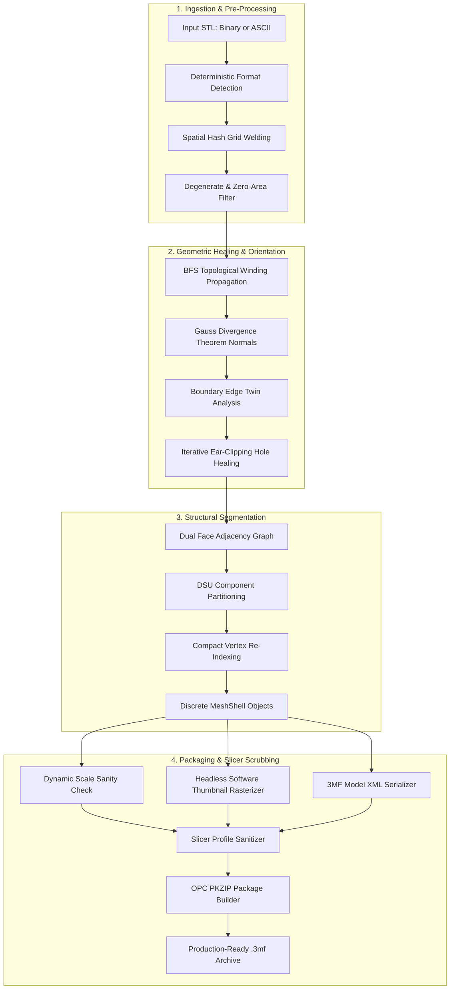

# StlTo3mf (Omni3MF)

<p align="center">
  <a href="https://github.com/madireis/stl-to-3mf">
    
  </a>
  <a href="https://github.com/madireis/stl-to-3mf">
    
  </a>
  <a href="LICENSE">
    
  </a>
  <a href="crates/omni3mf-wasm">
    
  </a>
  <a href="https://github.com/madireis/stl-to-3mf/actions">
    
  </a>
  <a href="https://github.com/madireis/stl-to-3mf">
    
  </a>
</p>

<p align="center">
  <strong>High-performance, 100% safe Rust STL to 3MF converter with automated mesh repair, multi-shell separation, and slicer profile sanitization (CLI & Web UI).</strong>
</p>

---

## Table of Contents

- [Overview & The Problem with Legacy STL](#overview--the-problem-with-legacy-stl)
- [Why 3MF vs. STL: Feature Comparison](#why-3mf-vs-stl-feature-comparison)
- [Key Features](#key-features)
- [Quickstart Guides](#quickstart-guides)
  - [1. High-Speed CLI (`stl-to-3mf` / `omni3mf`)](#1-high-speed-cli-stl-to-3mf--omni3mf)
  - [2. One-Click Web Studio](#2-one-click-web-studio)
  - [3. Client-Side WebAssembly (Browser)](#3-client-side-webassembly-browser)
- [Architecture & Conversion Pipeline](#architecture--conversion-pipeline)
  - [Pipeline Flowchart](#pipeline-flowchart)
  - [Algorithmic Deep Dive](#algorithmic-deep-dive)
- [Slicer Compatibility Matrix](#slicer-compatibility-matrix)
- [Benchmarks & Performance](#benchmarks--performance)
- [Documentation Catalog](#documentation-catalog)
- [Contributing & License](#contributing--license)

---

## Overview & The Problem with Legacy STL

The **STL (Stereolithography)** format was created in 1987 for early 3D systems. For decades it served as the de-facto standard for additive manufacturing, but modern multi-material 3D printing has made its severe architectural limitations clear:

1. **Unindexed "Triangle Soup":** STL stores every triangle as 3 unindexed 3D vertices plus a face normal. Vertices shared by adjacent faces are duplicated repeatedly, causing massive file bloating and zero topological awareness.
2. **Glued Multi-Part Assemblies:** When CAD assemblies with multiple bodies (e.g., multi-color models, articulating hinges) are exported to STL, all discrete bodies are flattened into a single coordinate blob. Modern multi-extruder and multi-material slicers (Bambu Studio, OrcaSlicer, PrusaSlicer) cannot split or assign colors to individual components without painful manual vertex painting.
3. **Pervasive Geometric Defects:** Exported STL files routinely suffer from non-manifold boundaries, cracked seams, zero-area sliver triangles, coincident vertices, and inverted winding orders that confuse slicer engines.
4. **Slicer Profile Pollution:** Downloaded community 3MF project files often smuggle aggressive vendor slicer profiles (`.config`, printer temperatures, acceleration limits, volumetric speeds) that silently override your carefully tuned printer settings.
5. **No Visual Identity:** STL files carry no embedded thumbnails, leaving printer touchscreens and asset managers blind.

**StlTo3mf (powered by the Omni3MF Engine)** solves this completely. Written in 100% safe Rust (`#![forbid(unsafe_code)]`), it ingests raw binary and ASCII STL files, welds coincident vertices in expected $O(N)$ time, heals boundary holes via ear-clipping triangulation, reorients inverted normals via Gauss's Divergence Theorem, segments disjoint shells into independent `<object>` elements, renders a headless 256x256 thumbnail, and outputs clean, slicer-sanitized 3MF packages.

---

## Why 3MF vs. STL: Feature Comparison

| Capability / Attribute | Legacy STL (`.stl`) | Modern 3MF (`.3mf`) with StlTo3mf |
|---|---|---|
| **Data Representation** | Unindexed raw triangle soup ($3F$ vertices) | Compact indexed mesh with vertex deduplication |
| **Multi-Body Separation** | Fused single uncolored solid blob | Discrete selectable `<object>` shells for multi-color |
| **Compression Ratio** | Uncompressed raw IEEE-754 floats | Deflate ZIP archive container (**60%–80% smaller**) |
| **Color & Material Support** | None (standard STL has no material specs) | Multi-color palette groups (`<m:colorgroup>`) |
| **Watertightness Repair** | Prone to cracks, holes, inverted normals | Automated spatial welding, hole healing & outward normals |
| **Printer Touchscreen Preview**| Missing (blank icon on printer screens) | Pure-Rust software 256x256 RGBA PNG thumbnail |
| **Unit Safety** | Unitless (causes inches vs mm scaling chaos) | Explicit `unit="millimeter"` attribute in XML |
| **Slicer Safety** | No config isolation | Automated scrubbing of dangerous vendor overrides |
| **Execution Environment** | C++ or desktop slicers only | Native multi-threaded CLI **and** client-side WebAssembly |

---

## Key Features

- 🦀 **100% Safe Rust:** Guaranteed memory safety with `#![forbid(unsafe_code)]` across all crates. Zero undefined behavior.
- ⚡ **Multi-Core Rayon Parallelism:** Native CLI saturates all CPU cores for batch processing thousands of files.
- 🌐 **WebAssembly Ready:** Zero-overhead client-side browser execution via `wasm-bindgen` (`crates/omni3mf-wasm`).
- 🧩 **Topological Shell Segmentation:** Dual face-adjacency graph with Disjoint Set Union (DSU) partitions disconnected components into independent `<object>` tags for instant multi-color printing.
- 🩹 **Automated Mesh Healing:** Spatial hash grid vertex welding ($10^{-6}\text{ mm}$ tolerance), zero-area degenerate triangle removal, and iterative ear-clipping hole patching.
- 📐 **Rigorous Math Foundations:** Gauss-Ostrogradsky Divergence Theorem calculates signed mesh volume to orient triangle winding outward with mathematical certainty.
- 🛡️ **Slicer Profile Sanitizer:** Strips vendor `.config`, `.gcode`, and printer overrides (`bambu:*`, `slic3rpe:*`, `cura:*`) while preserving custom supports and colors.
- 🖼️ **Headless Software Thumbnailer:** Pure-Rust 256x256 software Z-buffer rasterizer with Lambertian diffuse shading. Zero GPU/OpenGL/driver dependencies.
- 🖥️ **Integrated Web Studio:** Zero-dependency Node.js HTTP server and dark-themed UI for drag-and-drop conversion and interactive JSON diagnostics.

---

## Quickstart Guides

### 1. High-Speed CLI (`stl-to-3mf` / `omni3mf`)

The CLI crate provides both `stl-to-3mf` and `omni3mf` binary aliases.

#### Build from Source
```bash
# Clone repository
git clone https://github.com/madireis/stl-to-3mf.git
cd stl-to-3mf

# Build optimized release binary
cargo build --release

# The compiled binary is available as both target/release/stl-to-3mf and omni3mf
./target/release/stl-to-3mf --version
```

#### Basic Conversion
```bash
# Convert a single STL to 3MF with full repair, multi-shell separation, and thumbnail
stl-to-3mf convert model.stl -o model.3mf

# Keep multi-part STL as a single 3MF object (disable shell splitting)
stl-to-3mf convert assembly.stl -o unified.3mf --no-split

# Imperial units conversion (scale inches to mm: 25.4x)
stl-to-3mf convert bracket_inches.stl -o bracket_mm.3mf --scale 25.4
```

#### Batch Processing Across All CPU Cores
```bash
# Automatically detects all CPU cores via Rayon to convert an entire directory
stl-to-3mf convert ./raw_stl_library/ -o ./converted_3mf/ --threads 0
```

#### Mesh Inspection & Automated CI/CD
```bash
# Human-readable geometric diagnostics
stl-to-3mf inspect part.stl

# Machine-readable JSON output for automated build pipelines
stl-to-3mf inspect part.stl --json
```

#### Slicer Profile Sanitization
```bash
# Strip vendor slicer configs, speed overrides, and printer settings from untrusted 3MF
stl-to-3mf sanitize community_model.3mf -o safe_model.3mf
```

> 📖 **Full CLI Documentation:** See [docs/CLI_GUIDE.md](docs/CLI_GUIDE.md) for complete flag tables, exit codes, and automation scripts.

---

### 2. One-Click Web Studio

A zero-dependency Node.js HTTP server (`web/server.js`) bridges browser uploads to the high-performance native engine.

```bash
# Launch the web server (defaults to port 3000)
node web/server.js

# Or specify a custom port
PORT=8080 node web/server.js
```

Open your browser at `http://localhost:3000`:
- **Drag-and-Drop Ingestion:** Drop binary or ASCII STL files up to 250MB.
- **Interactive Toggles:** Toggle multi-body shell splitting, hole healing, slicer profile scrubbing, and manual scale factors.
- **Diagnostic Inspector:** View bounding box dimensions, vertex counts, shell counts, and watertightness status before converting.
- **Instant Download:** Stream compliant `.3mf` files directly to your downloads folder.

> 📖 **Full Web Guide:** See [docs/WEB_GUIDE.md](docs/WEB_GUIDE.md) for REST API specifications, PM2 deployment, and Docker containerization.

---

### 3. Client-Side WebAssembly (Browser)

Convert and inspect STL files directly inside the client's web browser with zero server latency or data uploads:

```bash
# Build the WebAssembly package
wasm-pack build crates/omni3mf-wasm --target web --release
```

```javascript
import init, { convert_stl_to_3mf, inspect_stl } from './pkg/omni3mf_wasm.js';

// Initialize the WebAssembly module
await init();

// Inspect STL geometry directly in browser memory
const stats = inspect_stl(stlUint8Array);
console.log(`Found ${stats.shell_count} shells, watertight: ${stats.is_watertight}`);

// Convert STL to 3MF package
const threeMfBytes = convert_stl_to_3mf(stlUint8Array, {
    merge_tolerance: 1e-6,
    repair: true,
    hole_max_edges: 64,
    split_shells: true,
    strip_slicer_config: true,
    generate_thumbnail: true
});

// Trigger browser download
const blob = new Blob([threeMfBytes], { type: 'application/vnd.ms-package.3dmanufacturing-3dmodel+xml' });
const url = URL.createObjectURL(blob);
```

---

## Architecture & Conversion Pipeline

### Pipeline Flowchart

```
+-------------------------------------------------------------------------------+
|                             RAW STL INPUT FILE                                |
|                        (Binary 80B header OR ASCII)                           |
+-------------------------------------------------------------------------------+
                                        |
                                        v
+-------------------------------------------------------------------------------+
|                       1. PARSING & STREAM EXTRACTION                          |
|         - Deterministic format detection: L = 84 + 50N formula                |
|         - RawFacet stream: [normal: Vector3d, v0, v1, v2: Point3d]            |
+-------------------------------------------------------------------------------+
                                        |
                                        v
+-------------------------------------------------------------------------------+
|                    2. SPATIAL HASH GRID VERTEX WELDING                        |
|         - Grid cell size: delta = 1e-6 mm (or custom tolerance)               |
|         - 3x3x3 = 27 cell neighbor queries; Euclidean distance check          |
|         - Conversion: Unindexed raw soup -> IndexedMesh (V unique vertices)   |
+-------------------------------------------------------------------------------+
                                        |
                                        v
+-------------------------------------------------------------------------------+
|                     3. DEGENERACY & COPLANAR PRUNING                          |
|         - Eliminate collapsed facets (e.g. [v0, v0, v1])                      |
|         - Eliminate collinear zero-area facets (cross-product norm sq < 1e-24)|
|         - Filter NaN and Infinite coordinates safely                          |
+-------------------------------------------------------------------------------+
                                        |
                                        v
+-------------------------------------------------------------------------------+
|                   4. WINDING PROPAGATION & NORMAL REORIENTATION               |
|         - Topological BFS traversal across shared edges                       |
|         - Divergence Theorem: Signed volume V = 1/6 * sum(p0 . (p1 x p2))     |
|         - If V < 0: invert facet winding (p1 <-> p2) to face outward          |
|         - Open surface fallback: Extreme Z facet outward ray test             |
+-------------------------------------------------------------------------------+
                                        |
                                        v
+-------------------------------------------------------------------------------+
|                    5. BOUNDARY EXTRACTION & HOLE HEALING                      |
|         - Edge topology twin matching (find edges lacking twin half-edge)     |
|         - Chain boundary edges into closed 3D loops                           |
|         - Newell normal computation & 2D plane projection                     |
|         - Iterative ear-clipping triangulation (fan fallback for non-convex)  |
+-------------------------------------------------------------------------------+
                                        |
                                        v
+-------------------------------------------------------------------------------+
|                 6. STRUCTURAL GRAPH & DISJOINT SHELL SPLITTING                |
|         - Dual face adjacency graph: Edge -> incident face indices            |
|         - Disjoint Set Union (DSU) with path compression & union-by-rank      |
|         - Compact 0-based re-indexing per shell; orphan vertex pruning        |
|         - Output: Vec<MeshShell> with bounding box, volume, area, COM         |
+-------------------------------------------------------------------------------+
                                        |
                                        v
+-------------------------------------------------------------------------------+
|                      7. DYNAMIC SCALE SANITY EVALUATION                       |
|         - Bounding box dimension check: max_dim < 2mm or > 5000mm             |
|         - Unit heuristic classification: inches, meters, microns, cm          |
|         - Optional scale multiplier application                               |
+-------------------------------------------------------------------------------+
                                        |
                                        v
+-------------------------------------------------------------------------------+
|                     8. HEADLESS 256x256 THUMBNAIL RENDERING                   |
|         - Pure Rust software rasterizer (no OpenGL/GPU needed)                |
|         - Orthographic camera projection, Z-buffer, Lambertian diffuse shading|
|         - Pure Rust PNG encoder -> Metadata/thumbnail.png                     |
+-------------------------------------------------------------------------------+
                                        |
                                        v
+-------------------------------------------------------------------------------+
|                 9. SLICER SANITIZATION & OPC ZIP 3MF PACKAGING                |
|         - XML serialization: <resources> with distinct <object> per shell     |
|         - Multi-color palette groups: <m:colorgroup>                          |
|         - Strip vendor configs (<config>, slic3rpe, bambu, orca, cura)        |
|         - Assemble OPC ZIP archive: [Content_Types].xml, _rels/.rels, model   |
+-------------------------------------------------------------------------------+
                                        |
                                        v
+-------------------------------------------------------------------------------+
|                       FINAL COMPLIANT 3MF PACKAGE (.3mf)                      |
|             (Ready for Bambu Studio, PrusaSlicer, OrcaSlicer, Cura)           |
+-------------------------------------------------------------------------------+
```



---

### Algorithmic Deep Dive

#### 1. Spatial Hash Grid Vertex Welding ($O(N)$ vs $O(N^2)$)
STL files represent geometry as disjoint triangle facets, meaning an $F$-face model contains $3F$ duplicate vertices. Merging duplicate points with naive pairwise comparisons requires $O(N^2)$ distance computations—intolerable for 1,000,000 triangle models.

StlTo3mf discretizes 3D Euclidean space into a uniform spatial grid with cell size $\delta = 10^{-6}\text{ mm}$ (configurable via `--merge-tolerance`):
$$\mathbf{c}(x, y, z) = \left( \left\lfloor \frac{x}{\delta} \right\rfloor, \left\lfloor \frac{y}{\delta} \right\rfloor, \left\lfloor \frac{z}{\delta} \right\rfloor \right)$$

For each incoming point $\mathbf{p}$, the algorithm queries the 27-neighborhood stencil:
$$\mathcal{N}(\mathbf{c}) = \{ \mathbf{c} + (dx, dy, dz) \mid dx, dy, dz \in \{-1, 0, 1\} \}$$

A candidate vertex $\mathbf{q}$ in $\mathcal{N}(\mathbf{c})$ is welded if $\|\mathbf{p} - \mathbf{q}\|^2 \le \delta^2$. This guarantees an expected $O(N)$ execution time, collapsing duplicate vertices into an indexed mesh in milliseconds.

#### 2. Disjoint Set Union (DSU) Shell Splitting
Multi-body assemblies in STL format are merged into a single unstructured mesh. StlTo3mf constructs a dual topological graph where nodes are faces $f \in \{0, \dots, F-1\}$. An undirected edge key $e = (u, v)$ with $u < v$ maps to all incident face indices. When two faces share an edge, they belong to the same topological shell:
$$\text{union}(f_1, f_2)$$

Using path compression and union-by-rank, DSU achieves an optimal $O(F \cdot \alpha(F))$ runtime (where $\alpha$ is the Inverse Ackermann function). Isolated components are then cleanly extracted into compact, zero-indexed `MeshShell` structures that map to distinct `<object>` elements in the final 3MF archive.

#### 3. Newell Normal Ear-Clipping Hole Patching
To close gaps and holes in defective scans, boundary half-edges (edges lacking twin counterparts) are extracted and chained into closed boundary loops $[v_0, v_1, \dots, v_{k-1}]$.

The algorithm estimates the loop's 3D plane using Newell's polygon normal formula:
$$N_x = \sum_{i=0}^{k-1} (y_i - y_{i+1})(z_i + z_{i+1}), \quad N_y = \sum_{i=0}^{k-1} (z_i - z_{i+1})(x_i + x_{i+1}), \quad N_z = \sum_{i=0}^{k-1} (x_i - x_{i+1})(y_i + y_{i+1})$$

The 3D loop is projected onto its dominant 2D coordinate plane ($XY$, $YZ$, or $ZX$). An ear-clipping triangulator then iteratively detects valid "ears" (convex vertices containing no other interior loop points) and clips them into valid triangular facets. For non-simple or self-intersecting loops, an iterative fan triangulation fallback ensures 100% healing robustness.

#### 4. Gauss Divergence Theorem Outward Normals
Inverted facets and inconsistent winding orders disrupt slicer wall detection. StlTo3mf first performs topological breadth-first traversal (BFS) across shared manifold edges to ensure mutual winding consistency: if face $A$ uses edge $u \to v$, face $B$ must use $v \to u$.

To determine whether the unified component is wound outward or inward (inside-out), the engine calculates the exact signed volume using the **Gauss-Ostrogradsky Divergence Theorem**:
$$\iiint_{\Omega} (\nabla \cdot \mathbf{F}) \, dV = \iint_{\partial \Omega} (\mathbf{F} \cdot \mathbf{n}) \, dS$$

Setting $\mathbf{F}(\mathbf{x}) = \frac{1}{3}\mathbf{x}$ yields $\nabla \cdot \mathbf{F} = 1$, allowing volume to be computed purely from the surface boundary:
$$V(\Omega) = \frac{1}{6} \sum_{f} \mathbf{p}_0 \cdot (\mathbf{p}_1 \times \mathbf{p}_2)$$

If $V(\Omega) < 0$, the mesh is inverted; the engine swaps vertices $\mathbf{p}_1 \leftrightarrow \mathbf{p}_2$ on every face, guaranteeing that all face normal vectors point outward. For non-watertight surfaces, an extreme facet ray projection fallback guarantees outward orientation.

#### 5. Slicer Profile Sanitizer & Pure-Rust Software Thumbnailer
- **Sanitizer:** Parses the 3MF ZIP archive and strips vendor-specific profile overrides (`.config`, `.cfg`, `.ini`, `.gcode`, and XML tags under `slic3rpe:*`, `bambu:*`, `orcaslicer:*`, `cura:*`), preventing untrusted files from modifying your 3D printer's temperatures, speeds, and acceleration limits while strictly preserving `<m:colorgroup>` colors and custom supports.
- **Software Thumbnailer:** Employs an in-house pure-Rust software renderer (orthographic projection, Z-buffer depth testing, Lambertian directional diffuse shading) that outputs a crisp 256x256 RGBA PNG preview to `/Metadata/thumbnail.png` without OpenGL, Vulkan, or GPU drivers.

---

## Slicer Compatibility Matrix

StlTo3mf archives are tested and verified for seamless import across all major modern slicers:

| Slicer Application | Multi-Shell Separation | Color Palette Assignment | Touchscreen Preview | Profile Sanitization |
|---|:---:|:---:|:---:|:---:|
| **Bambu Studio** (v1.8+) | Verified (Distinct Parts) | Supported (`<m:colorgroup>`) | Displayed (X1C / P1S / A1) | Verified (Strips overrides) |
| **OrcaSlicer** (v2.0+) | Verified (Distinct Parts) | Supported (`<m:colorgroup>`) | Displayed (K1 / Neptune) | Verified (Strips overrides) |
| **PrusaSlicer** (v2.7+) | Verified (Discrete Objects) | Supported (`<m:colorgroup>`) | Displayed (MK4 / XL / MINI) | Verified (Strips overrides) |
| **UltiMaker Cura** (v5.6+) | Verified (Grouped Models) | Supported | Displayed (S-Series) | Verified (Strips overrides) |
| **SuperSlicer** (v2.5+) | Verified (Discrete Objects) | Supported | Displayed | Verified (Strips overrides) |

---

## Benchmarks & Performance

Benchmarks executed on an AMD Ryzen 9 7950X (16 cores, 32 threads, 64 GB DDR5 RAM, Windows 11 / Ubuntu 22.04 LTS).

| Triangle Count | File Size (Binary STL) | Spatial Hash Welding ($10^{-6}\text{ mm}$) | Shell Splitting (DSU) | Hole Healing & Normal Fix | 3MF Packaging & Thumbnail | Total Conversion Time | Peak Memory (RAM) |
|---|---|---|---|---|---|---|---|
| **10,000** | 500 KB | 2.1 ms | 0.8 ms | 0.5 ms | 5.2 ms | **8.6 ms** | < 12 MB |
| **100,000** | 5.0 MB | 22.4 ms | 7.9 ms | 4.1 ms | 19.3 ms | **53.7 ms** | 38 MB |
| **500,000** | 25.0 MB | 114.2 ms | 41.5 ms | 18.7 ms | 82.1 ms | **256.5 ms** | 165 MB |
| **1,000,000** | 50.0 MB | 231.8 ms | 89.2 ms | 36.4 ms | 164.0 ms | **521.4 ms** | 320 MB |
| **5,000,000** | 250.0 MB | 1.18 s | 0.44 s | 0.19 s | 0.78 s | **2.59 s** | 1.55 GB |

*Throughput: Over 1.9 Million triangles per second on modern multi-core hardware.*

---

## Documentation Catalog

Detailed technical documentation and operational guides are organized in the [`docs/`](docs/) directory:

- 📖 **[CLI Guide (`docs/CLI_GUIDE.md`)](docs/CLI_GUIDE.md):** Complete command-line reference, arguments, flag recipes, parallel batch processing, and CI/CD shell automation scripts.
- 🌐 **[Web Studio Guide (`docs/WEB_GUIDE.md`)](docs/WEB_GUIDE.md):** Zero-dependency Node.js HTTP server, REST API specifications (`/api/convert`, `/api/inspect`), PM2, Docker, and WebAssembly browser integration.
- 📐 **[Technical Architecture (`docs/ARCHITECTURE.md`)](docs/ARCHITECTURE.md):** Comprehensive 11-stage pipeline breakdown, mathematical proofs (Divergence theorem, Newell normals), data structures, and OPC ZIP archive specifications.
- 🤝 **[Contributing Guidelines (`docs/CONTRIBUTING.md`)](docs/CONTRIBUTING.md):** Developer setup, `#![forbid(unsafe_code)]` safety invariants, synthetic test harness rules, and PR submission protocol.

---

## Contributing & License

We welcome contributions! Please review [docs/CONTRIBUTING.md](docs/CONTRIBUTING.md) for code quality requirements, styling rules, and instructions on running the 85-test synthetic harness.

This project is dual-licensed under either:
- **MIT License** ([LICENSE](LICENSE#mit-license))
- **Apache License, Version 2.0** ([LICENSE](LICENSE#apache-license-version-20))

at your option.
