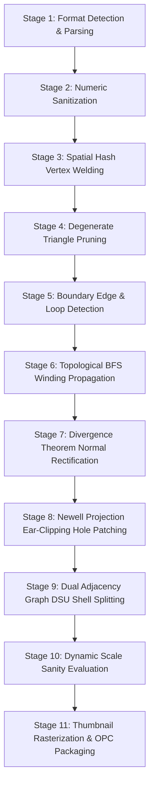

# StlTo3mf Technical Architecture & Mathematical Foundations

This document provides a comprehensive technical breakdown of **StlTo3mf** and its core geometry engine, **Omni3MF**. It covers the 11-stage processing pipeline, internal data structures, mathematical derivations and proofs, software rasterizer architecture, and 3MF Open Packaging Conventions (OPC) specifications.

---

## Table of Contents

- [Architectural Invariants](#architectural-invariants)
- [System Data Structures](#system-data-structures)
- [The 11-Stage Processing Pipeline](#the-11-stage-processing-pipeline)
  - [Stage 1: Format Detection & Facet Stream Ingestion](#stage-1-format-detection--facet-stream-ingestion)
  - [Stage 2: Numeric Sanitization & NaN / Inf Guarding](#stage-2-numeric-sanitization--nan--inf-guarding)
  - [Stage 3: Spatial Hash Grid Vertex Welding](#stage-3-spatial-hash-grid-vertex-welding)
  - [Stage 4: Degenerate Triangle & Sliver Pruning](#stage-4-degenerate-triangle--sliver-pruning)
  - [Stage 5: Directed Edge Adjacency & Boundary Loop Detection](#stage-5-directed-edge-adjacency--boundary-loop-detection)
  - [Stage 6: Topological BFS Winding Consistency](#stage-6-topological-bfs-winding-consistency)
  - [Stage 7: Outward Normal Rectification via Gauss's Divergence Theorem](#stage-7-outward-normal-rectification-via-gausss-divergence-theorem)
  - [Stage 8: Newell Normal Plane Projection & Iterative Ear-Clipping Hole Patching](#stage-8-newell-normal-plane-projection--iterative-ear-clipping-hole-patching)
  - [Stage 9: Dual Face Adjacency Graph & DSU Shell Splitting](#stage-9-dual-face-adjacency-graph--dsu-shell-splitting)
  - [Stage 10: Dynamic Scale Sanity Evaluation](#stage-10-dynamic-scale-sanity-evaluation)
  - [Stage 11: Headless Software Thumbnail Rasterization & OPC ZIP Packaging](#stage-11-headless-software-thumbnail-rasterization--opc-zip-packaging)
- [Mathematical Derivations & Proofs](#mathematical-derivations--proofs)
  - [1. Gauss-Ostrogradsky Divergence Theorem for Signed Volume](#1-gauss-ostrogradsky-divergence-theorem-for-signed-volume)
  - [2. Newell's Method for 3D Polygon Normal Estimation](#2-newells-method-for-3d-polygon-normal-estimation)
  - [3. Ear-Clipping Triangulation with Barycentric Point Containment](#3-ear-clipping-triangulation-with-barycentric-point-containment)
  - [4. Uniform Spatial Hashing Complexity Analysis](#4-uniform-spatial-hashing-complexity-analysis)
- [3MF Open Packaging Conventions (OPC) Architecture](#3mf-open-packaging-conventions-opc-architecture)
  - [Package Layout](#package-layout)
  - [`[Content_Types].xml`](#content_typesxml)
  - [`_rels/.rels`](#_relsrels)
  - [`3D/3dmodel.model` XML Architecture](#3d3dmodelmodel-xml-architecture)
  - [`Metadata/thumbnail.png`](#metadatathumbnailpng)
- [Thread Safety & Concurrency Model](#thread-safety--concurrency-model)

---

## Architectural Invariants

1. **Zero `unsafe` Code:** The codebase strictly enforces `#![forbid(unsafe_code)]` across all crates (`omni3mf-core`, `omni3mf-cli`, `omni3mf-wasm`). Memory safety, pointer validity, and thread safety are guaranteed by the Rust type system.
2. **Determinism:** Pipeline execution is 100% deterministic. Given identical input bytes and tolerance parameters, the output 3MF archive is byte-for-byte reproducible (subject to standard ZIP timestamp conventions).
3. **Pure-Rust Software Rendering:** The embedded thumbnail generator does not require an operating system display server (X11/Wayland/Quartz), GPU drivers, OpenGL, or Vulkan. It operates entirely in memory using a pure-Rust software Z-buffer rasterizer.
4. **Zero Third-Party Slicer Leakage:** Slicer profile sanitization scrubs proprietary configuration files without compromising geometric integrity or color definitions.

---

## System Data Structures

```
crates/omni3mf-core/src/
├── math/
│   ├── vec3.rs          -> Vector3d, Point3d (IEEE-754 f64 operations)
│   ├── bbox.rs          -> BoundingBox3d (min/max coordinates, dimensions)
│   └── numerics.rs      -> Float epsilon comparisons, safe determinant
├── mesh/
│   ├── indexed.rs       -> IndexedMesh (vertices: Vec<Point3d>, faces: Vec<[usize; 3]>)
│   ├── spatial_hash.rs  -> SpatialHashGrid (uniform grid vertex deduplication)
│   └── topology.rs      -> EdgeTopology, DirectedEdge, HalfEdge twin matching
├── repair/
│   ├── degenerate.rs    -> DegenerateFacetFilter (collinear/collapsed triangle removal)
│   ├── normals.rs       -> NormalRectifier (Gauss divergence signed volume check)
│   ├── boundary.rs      -> BoundaryLoopChain (twin-less half-edge cycle extractor)
│   └── hole_patcher.rs  -> EarClippingPatcher (Newell normal plane projection)
├── shell/
│   ├── graph.rs         -> FaceAdjacencyGraph, DisjointSetUnion (DSU)
│   └── separator.rs     -> ShellSeparator (MeshShell extraction, orphan pruning)
├── scale/
│   └── mod.rs           -> ScaleSanityEvaluator (bounding box heuristics)
├── thumbnail/
│   └── mod.rs           -> SoftwareRasterizer, ZBuffer, LambertianShader, PngWriter
└── package/
    ├── model_xml.rs     -> ThreeMfXmlSerializer (<resources>, <object>, <components>)
    └── zip_builder.rs   -> OpcZipBuilder (PKZIP Deflate compression)
```

### Core Type Signatures

#### `RawFacet`
```rust
#[derive(Debug, Clone, Copy)]
pub struct RawFacet {
    pub normal: Vector3d,
    pub vertices: [Point3d; 3],
    pub attribute_byte_count: u16,
}
```

#### `IndexedMesh`
```rust
#[derive(Debug, Clone)]
pub struct IndexedMesh {
    pub vertices: Vec<Point3d>,
    pub faces: Vec<[usize; 3]>,
}
```

#### `MeshShell`
```rust
#[derive(Debug, Clone)]
pub struct MeshShell {
    pub id: usize,
    pub name: String,
    pub mesh: IndexedMesh,
    pub bbox: BoundingBox3d,
    pub center_of_mass: Point3d,
    pub signed_volume: f64,
    pub surface_area: f64,
    pub is_watertight: bool,
}
```

---

## The 11-Stage Processing Pipeline



### Stage 1: Format Detection & Facet Stream Ingestion
The input byte slice is inspected to identify whether it is binary or ASCII STL:
- **Binary STL Check:** A valid binary STL file has length $L = 84 + 50 \times N$ bytes, where $N$ is the 32-bit unsigned integer stored at byte offset 80.
- **ASCII STL Check:** If the file size does not match the binary formula, the parser checks if the first non-whitespace tokens match `solid` and parses vertices using a streaming whitespace tokenizer that supports standard and scientific floating-point formats.

### Stage 2: Numeric Sanitization & NaN / Inf Guarding
Every vertex coordinate $(x, y, z)$ is tested for validity:
- Coordinates containing `f64::NAN`, `f64::INFINITY`, or `f64::NEG_INFINITY` are rejected or clamped.
- Subnormal floating-point values are flushed to zero to prevent CPU denormal slowdowns during geometric calculations.

### Stage 3: Spatial Hash Grid Vertex Welding
Raw STL stores 3 independent vertices per triangle. To build an indexed mesh (`IndexedMesh`), coincident vertices must be merged.
- StlTo3mf hashes coordinates into cubic cells of width $\delta = 10^{-6}\text{ mm}$.
- A 27-neighborhood stencil query tests Euclidean distances $\|\mathbf{p} - \mathbf{q}\|^2 \le \delta^2$.
- Converts unindexed $3F$ float tuples into $V$ unique vertices with expected $O(N)$ complexity.

### Stage 4: Degenerate Triangle & Sliver Pruning
Triangles collapsed during welding are identified and eliminated:
- **Collapsed Vertices:** Facets where $v_0 = v_1$, $v_1 = v_2$, or $v_2 = v_0$.
- **Collinear Slivers:** Facets where the squared norm of the face cross-product is negligible:
  $$\|(\mathbf{v}_1 - \mathbf{v}_0) \times (\mathbf{v}_2 - \mathbf{v}_0)\|^2 < 10^{-24}\text{ mm}^4$$
- Pruning eliminates divide-by-zero errors in downstream normal computations.

### Stage 5: Directed Edge Adjacency & Boundary Loop Detection
The mesh topology is analyzed using half-edge pairs:
- Directed edge $u \to v$ is stored in a hash map.
- If $u \to v$ lacks a matching twin edge $v \to u$, it is classified as a boundary edge.
- Boundary edges are chained into ordered closed boundary loops $\mathcal{C} = [v_0, v_1, \dots, v_{k-1}]$.

### Stage 6: Topological BFS Winding Propagation
For all connected manifold components, triangle winding is unified across shared edges:
- Starting from a seed face, breadth-first traversal walks across adjacent edges.
- If face $A$ uses edge $u \to v$, face $B$ sharing the same edge must traverse $v \to u$.
- If face $B$ also traverses $u \to v$, its vertex order is inverted ($v_1 \leftrightarrow v_2$).

### Stage 7: Outward Normal Rectification via Gauss's Divergence Theorem
Even with mutually consistent winding, an entire component may be wound inside-out.
- The signed volume $V(\Omega)$ is computed via the Gauss-Ostrogradsky Divergence Theorem:
  $$V(\Omega) = \frac{1}{6} \sum_{f} \mathbf{p}_0 \cdot (\mathbf{p}_1 \times \mathbf{p}_2)$$
- If $V(\Omega) < 0$, the shell is inside-out; all face indices are swapped ($v_1 \leftrightarrow v_2$) to point outward.
- For open non-watertight sheets where volume is undefined, an extreme facet ray projection fallback aligns normals towards the positive external hemisphere.

### Stage 8: Newell Normal Plane Projection & Iterative Ear-Clipping Hole Patching
Extracted boundary loops under `--hole-max-edges` (default: 64) are healed:
- Newell's formula calculates the best-fit 3D normal vector of the polygon loop.
- The loop is projected into 2D along its dominant coordinate plane ($XY$, $YZ$, or $ZX$).
- An ear-clipping triangulator tests convex vertices and barycentric point containment, clipping ears until the hole is completely sealed.
- Non-convex or self-intersecting loops fall back to an iterative fan patcher.

### Stage 9: Dual Face Adjacency Graph & DSU Shell Splitting
- A dual graph maps undirected edges $(u, v)$ to incident face indices.
- Disjoint Set Union (DSU) partitions the face set into independent connected shells.
- Each shell undergoes compact 0-based vertex re-indexing, discarding orphan vertices.
- Output: `Vec<MeshShell>`, each with its own volume, surface area, center of mass, and bounding box.

### Stage 10: Dynamic Scale Sanity Evaluation
The overall bounding box is analyzed against 3D printing physical build volumes:
- Maximum dimension $< 2.0\text{ mm}$: Diagnosed as inches ($25.4\times$) or meters ($1000\times$).
- Maximum dimension $> 5000.0\text{ mm}$: Diagnosed as micrometers ($0.001\times$) or centimeters ($0.1\times$).
- Heuristics report suggested scale multipliers in CLI and Web outputs.

### Stage 11: Headless Software Thumbnail Rasterization & OPC ZIP Packaging
- **Thumbnail:** Renders an orthographic preview of all shells onto a $256 \times 256$ RGBA frame with floating-point Z-buffering and Lambertian diffuse shading. Encoded to pure-Rust PNG.
- **OPC ZIP Packaging:** Compiles `[Content_Types].xml`, `_rels/.rels`, `3D/3dmodel.model` (containing `<resources>` and `<build>` elements for all shells), and `Metadata/thumbnail.png` into a Deflate-compressed PKZIP archive.
- **Sanitization:** If requested, strips vendor `.config` and G-code files while preserving color palettes.

---

## Mathematical Derivations & Proofs

### 1. Gauss-Ostrogradsky Divergence Theorem for Signed Volume

**Theorem:** Let $\Omega \subset \mathbb{R}^3$ be a compact, orientable 3-manifold with piecewise smooth boundary $\partial \Omega$. For any continuously differentiable vector field $\mathbf{F}: \Omega \to \mathbb{R}^3$:
$$\iiint_{\Omega} (\nabla \cdot \mathbf{F}) \, dV = \iint_{\partial \Omega} (\mathbf{F} \cdot \mathbf{n}) \, dS$$
where $\mathbf{n}$ is the outward-pointing unit normal.

**Derivation for Polyhedral Surfaces:**
Choose the linear vector field:
$$\mathbf{F}(\mathbf{x}) = \frac{1}{3}\mathbf{x} = \frac{1}{3}(x\hat{\mathbf{i}} + y\hat{\mathbf{j}} + z\hat{\mathbf{k}})$$

The divergence is constant:
$$\nabla \cdot \mathbf{F} = \frac{1}{3}\left(\frac{\partial x}{\partial x} + \frac{\partial y}{\partial y} + \frac{\partial z}{\partial z}\right) = \frac{1}{3}(1 + 1 + 1) = 1$$

Substituting into the volume integral:
$$V(\Omega) = \iiint_{\Omega} 1 \, dV = \iiint_{\Omega} (\nabla \cdot \mathbf{F}) \, dV = \frac{1}{3} \iint_{\partial \Omega} (\mathbf{x} \cdot \mathbf{n}) \, dS$$

For a surface discretized into triangular facets $f_i = (\mathbf{p}_0, \mathbf{p}_1, \mathbf{p}_2)$, the outward area-weighted normal vector is:
$$\mathbf{A}_i = \frac{1}{2} (\mathbf{p}_1 - \mathbf{p}_0) \times (\mathbf{p}_2 - \mathbf{p}_0) = \frac{1}{2} (\mathbf{p}_0 \times \mathbf{p}_1 + \mathbf{p}_1 \times \mathbf{p}_2 + \mathbf{p}_2 \times \mathbf{p}_0)$$

The centroid of facet $f_i$ is $\bar{\mathbf{x}}_i = \frac{1}{3}(\mathbf{p}_0 + \mathbf{p}_1 + \mathbf{p}_2)$. Evaluating the surface integral:
$$\iint_{f_i} (\mathbf{x} \cdot \mathbf{n}) \, dS = \bar{\mathbf{x}}_i \cdot \mathbf{A}_i = \frac{1}{2} \mathbf{p}_0 \cdot (\mathbf{p}_1 \times \mathbf{p}_2)$$

Summing across all faces yields the exact signed volume:
$$V(\Omega) = \frac{1}{6} \sum_{i=1}^{F} \mathbf{p}_{0, i} \cdot (\mathbf{p}_{1, i} \times \mathbf{p}_{2, i})$$

**Decision Rule:**
- If $V(\Omega) > 0$, the surface facets are consistently wound **counter-clockwise** when viewed from the exterior (outward-pointing normals).
- If $V(\Omega) < 0$, the surface is wound **clockwise** (inward-pointing normals). The engine inverts all faces by swapping vertices $\mathbf{p}_1 \leftrightarrow \mathbf{p}_2$.

---

### 2. Newell's Method for 3D Polygon Normal Estimation

For non-planar 3D boundary loops $[v_0, v_1, \dots, v_{k-1}]$, a simple cross-product of two edges is sensitive to collinearity or local noise. Newell's method computes the exact surface area projection across all three cardinal planes:

$$N_x = \sum_{i=0}^{k-1} (y_i - y_{i+1})(z_i + z_{i+1})$$
$$N_y = \sum_{i=0}^{k-1} (z_i - z_{i+1})(x_i + x_{i+1})$$
$$N_z = \sum_{i=0}^{k-1} (x_i - x_{i+1})(y_i + y_{i+1})$$

where index $k \equiv 0$ (cyclic loop).

The unit normal is obtained by normalizing $\mathbf{N} = (N_x, N_y, N_z)$:
$$\hat{\mathbf{n}} = \frac{\mathbf{N}}{\|\mathbf{N}\|}$$

**Dominant Plane Projection:**
To project the 3D loop into 2D coordinates $(u, v)$ for triangulation, the axis with the maximum absolute normal component is dropped:
$$\text{axis} = \arg\max (|n_x|, |n_y|, |n_z|)$$
- If $|n_z|$ is largest: project onto the $XY$-plane: $(u_i, v_i) = (x_i, y_i)$.
- If $|n_x|$ is largest: project onto the $YZ$-plane: $(u_i, v_i) = (y_i, z_i)$.
- If $|n_y|$ is largest: project onto the $ZX$-plane: $(u_i, v_i) = (z_i, x_i)$.

This projection minimizes distortion and prevents coordinate degeneracy.

---

### 3. Ear-Clipping Triangulation with Barycentric Point Containment

An ordered 2D polygon $P = [w_0, w_1, \dots, w_{m-1}]$ has an "ear" at vertex $w_i$ (with neighbors $w_{i-1}$ and $w_{i+1}$) if:
1. $w_i$ is strictly **convex**:
   $$\det\begin{pmatrix} w_{i-1}.u & w_{i-1}.v & 1 \\ w_i.u & w_i.v & 1 \\ w_{i+1}.u & w_{i+1}.v & 1 \end{pmatrix} > 0$$
2. No other vertex $w_j \in P \setminus \{w_{i-1}, w_i, w_{i+1}\}$ lies inside or on the boundary of triangle $\Delta(w_{i-1}, w_i, w_{i+1})$.

**Barycentric Coordinate Point Containment:**
A point $\mathbf{p}$ lies inside $\Delta(\mathbf{a}, \mathbf{b}, \mathbf{c})$ if and only if its barycentric coordinates $(\lambda_1, \lambda_2, \lambda_3)$ satisfy:
$$\lambda_1 \ge 0, \quad \lambda_2 \ge 0, \quad \lambda_3 \ge 0, \quad \lambda_1 + \lambda_2 + \lambda_3 = 1$$
computed via:
$$\lambda_1 = \frac{(\mathbf{b}_v - \mathbf{c}_v)(\mathbf{p}_u - \mathbf{c}_u) + (\mathbf{c}_u - \mathbf{b}_u)(\mathbf{p}_v - \mathbf{c}_v)}{\text{det}}, \quad \lambda_2 = \frac{(\mathbf{c}_v - \mathbf{a}_v)(\mathbf{p}_u - \mathbf{c}_u) + (\mathbf{a}_u - \mathbf{c}_u)(\mathbf{p}_v - \mathbf{c}_v)}{\text{det}}$$
$$\lambda_3 = 1 - \lambda_1 - \lambda_2$$
where $\text{det} = (\mathbf{b}_v - \mathbf{c}_v)(\mathbf{a}_u - \mathbf{c}_u) + (\mathbf{c}_u - \mathbf{b}_u)(\mathbf{a}_v - \mathbf{c}_v)$.

Once verified, the ear $\Delta(w_{i-1}, w_i, w_{i+1})$ is appended to the mesh faces, vertex $w_i$ is removed from the loop, and the algorithm repeats until $m = 3$.

---

### 4. Uniform Spatial Hashing Complexity Analysis

Given $N$ points in bounded volume $V_{\text{box}} = W_x \times W_y \times W_z$ with cell width $\delta$:
- Number of cells along axis: $M_k = \lceil W_k / \delta \rceil$.
- Total discrete cells: $M = M_x M_y M_z$.
- Hash function: $H(c_x, c_y, c_z) = (c_x \cdot 73856093) \oplus (c_y \cdot 19349663) \oplus (c_z \cdot 83492791) \pmod K$.

Since 3D mesh points are distributed across 2D manifold surfaces rather than filling the entire 3D volume, the average number of points per occupied cell is bounded by a small constant $C \ll N$.

Searching the 27 neighboring cells inspects at most $27 \cdot C$ candidate vertices. The expected time for insertion and query is:
$$\mathbb{E}[T(N)] = O(1) \implies \text{Total Pipeline Welding Time: } O(N)$$
compared to $O(N^2)$ for pairwise all-to-all comparisons.

---

## 3MF Open Packaging Conventions (OPC) Architecture

A 3MF file is a standard PKZIP archive structured in compliance with the **3MF Core Specification v1.x**.

### Package Layout

```
model.3mf (ZIP Archive)
├── [Content_Types].xml
├── _rels/
│   └── .rels
├── 3D/
│   ├── 3dmodel.model
│   └── _rels/
│       └── 3dmodel.model.rels (optional, links thumbnail)
└── Metadata/
    └── thumbnail.png
```

### `[Content_Types].xml`
Declares the MIME types for all parts within the package:
```xml
<?xml version="1.0" encoding="UTF-8"?>
<Types xmlns="http://schemas.openxmlformats.org/package/2006/content-types">
  <Default Extension="rels" ContentType="application/vnd.openxmlformats-package.relationships+xml"/>
  <Default Extension="model" ContentType="application/vnd.ms-package.3dmanufacturing-3dmodel+xml"/>
  <Default Extension="png" ContentType="image/png"/>
</Types>
```

### `_rels/.rels`
Specifies package-level root relationships targeting the primary 3D model:
```xml
<?xml version="1.0" encoding="UTF-8"?>
<Relationships xmlns="http://schemas.openxmlformats.org/package/2006/relationships">
  <Relationship Target="/3D/3dmodel.model" Id="rel0" Type="http://schemas.microsoft.com/3dmanufacturing/2013/01/3dmodel"/>
  <Relationship Target="/Metadata/thumbnail.png" Id="rel1" Type="http://schemas.openxmlformats.org/package/2006/relationships/metadata/thumbnail"/>
</Relationships>
```

### `3D/3dmodel.model` XML Architecture
Contains the geometric definitions. Multi-shell meshes are partitioned into discrete `<object>` elements referenced in `<build>`:

```xml
<?xml version="1.0" encoding="UTF-8"?>
<model unit="millimeter" xml:lang="en-US"
       xmlns="http://schemas.microsoft.com/3dmanufacturing/core/2015/02"
       xmlns:m="http://schemas.microsoft.com/3dmanufacturing/material/2015/02">
  <metadata name="Title">StlTo3mf Multi-Shell Export</metadata>
  <metadata name="Application">StlTo3mf (Omni3MF Engine)</metadata>
  
  <resources>
    <!-- Object 1: Shell A -->
    <object id="1" name="Shell_01" type="model">
      <mesh>
        <vertices>
          <vertex x="0.000000" y="0.000000" z="0.000000" />
          <vertex x="10.000000" y="0.000000" z="0.000000" />
          <vertex x="10.000000" y="10.000000" z="0.000000" />
        </vertices>
        <triangles>
          <triangle v1="0" v2="1" v3="2" />
        </triangles>
      </mesh>
    </object>

    <!-- Object 2: Shell B -->
    <object id="2" name="Shell_02" type="model">
      <mesh>
        <vertices>
          <vertex x="50.000000" y="50.000000" z="0.000000" />
          <vertex x="60.000000" y="50.000000" z="0.000000" />
          <vertex x="60.000000" y="60.000000" z="0.000000" />
        </vertices>
        <triangles>
          <triangle v1="0" v2="1" v3="2" />
        </triangles>
      </mesh>
    </object>
  </resources>

  <build>
    <item objectid="1" />
    <item objectid="2" />
  </build>
</model>
```

### `Metadata/thumbnail.png`
- Dimensions: $256 \times 256$ pixels.
- Format: 8-bit RGBA PNG with alpha channel.
- Rendered using an orthographic projection centered on the combined model's bounding box center, illuminated by a directional key light vector $\mathbf{L} = \frac{1}{\sqrt{3}}(1, 1, 1)$ with ambient intensity $I_a = 0.35$ and diffuse coefficient $I_d = 0.65$.

---

## Thread Safety & Concurrency Model

StlTo3mf achieves high conversion throughput via two distinct concurrency mechanisms:

1. **Rayon Batch Parallelism (CLI):**
   When converting directories of STL files, the CLI dispatches individual file conversion tasks across a Rayon thread pool (`rayon::iter::ParallelIterator`). The thread pool size is configurable via `--threads <usize>` (defaulting to all logical CPU cores).
2. **Lock-Free Pipeline Execution:**
   The conversion pipeline (`convert_stl_to_3mf`) operates on immutable byte buffers and produces independent output buffers without shared mutable state or global locks. This makes the core engine completely safe to run concurrently inside web server workers, background threads, or actor frameworks.
